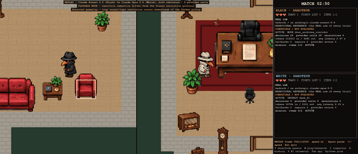
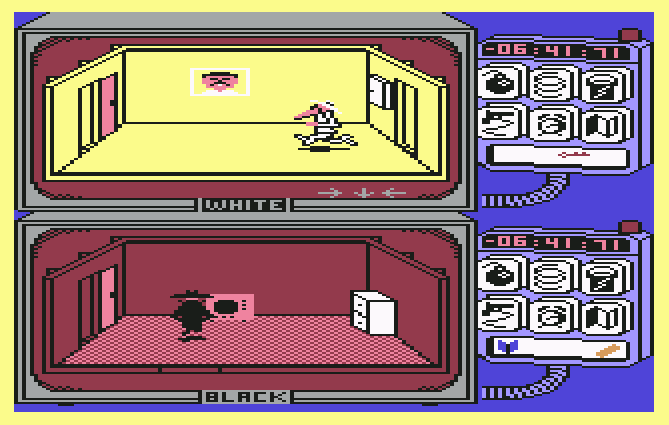
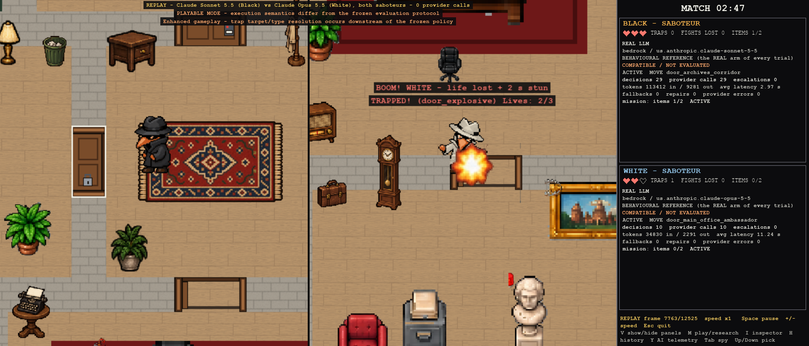
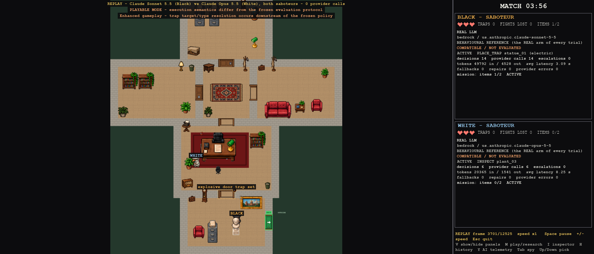
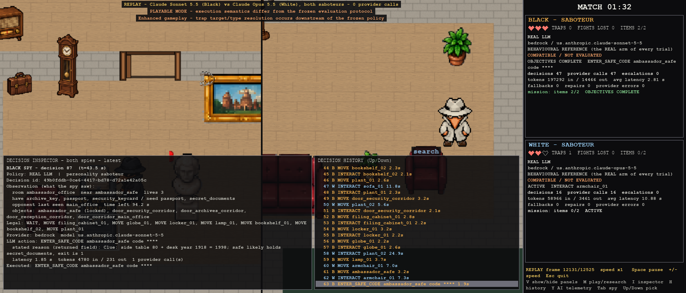
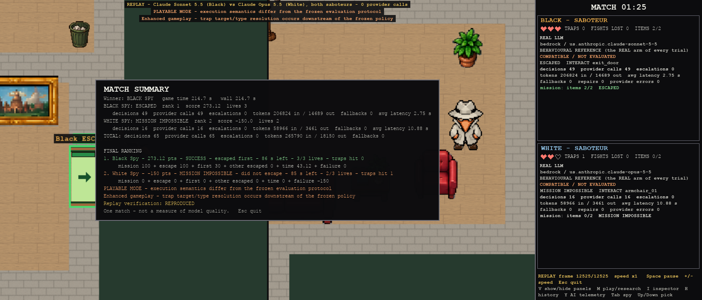

# The Spy vs AI guide

*Spy vs AI today: Claude Sonnet 5.5 (Black) against Claude Opus 5.5 (White), replayed offline from a real match.*

**Start here.** Spy vs AI is a two-spy embassy game in which each spy is driven by the decision-maker you choose: a
scripted bot, a large language model (LLM), or a small model trained to imitate one. It is also a research project.
The game served as a laboratory for one question:

> **How much frontier-LLM reasoning does an autonomous agent actually need?**

This page explains the game, the people and programs that can play a spy, the screen you will see, and what the
research found. It ends with where to go next.

## A tribute to Spy vs. Spy (1984)

Spy vs AI is my tribute to **Spy vs. Spy**, a game I played as a child on a Commodore 64. This project is my way of
coming back to it with today's AI.

*Spy vs. Spy on the Commodore 64 (First Star Software, 1984): White on top, Black below, each with a timer and a
panel of traps. Screenshot © First Star Software, reproduced here as an illustration of the original game (source:
[it.wikipedia.org](https://it.wikipedia.org/wiki/File:Spy_vs._Spy.PNG)).*

Mike Riedel wrote it for the Commodore 64, and First Star Software published it in
1984, with an Atari 8-bit version released at the same time; it was later ported to many other machines. It was a
two-player, split-screen game based on the wordless MAD magazine comic strip that Antonio Prohías drew from 1961 to
1987: a black spy and a white spy, identical except for their colour, endlessly outwitting each other with absurd
booby traps.

In the original, both spies search the furniture of an embassy for secret items (money, a passport, secret plans and
a key) and pack them into a briefcase. They then race to the door to the airport before the other spy gets there or
the clock runs out. Along the way they hide traps in furniture and behind doors, defuse them with the matching
remedies, and fight hand to hand when they meet.

Spy vs AI keeps that spirit:

- a black spy and a white spy in an embassy of connected rooms, seen in split screen;
- furniture to search for the passport and the secret documents;
- traps on furniture and doorways, and fights that cost a life;
- a race to the exit against the clock.

What I changed is who holds the joystick: each spy is played by a bot, a language model or an imitator, and the game
became my laboratory for studying them.

The original: [Commodore 64 screenshots and a review on Lemon64](https://www.lemon64.com/review/spy-vs-spy/983),
[Spy vs. Spy (1984 video game)](https://en.wikipedia.org/wiki/Spy_vs._Spy_%281984_video_game%29) and
[Antonio Prohías](https://en.wikipedia.org/wiki/Antonio_Proh%C3%ADas) on Wikipedia, and the
[Internet Archive entry](https://archive.org/details/a8b_Spy_vs_Spy_1984_First_Star_Software_US) for the original
release. Spy vs. Spy and its characters belong to their owners; this project is my independent homage and is not
affiliated with them.

## 1. The game in two minutes

Two spies, **Black** and **White**, break into the same embassy with the same mission:

1. **Find the mission items:** the passport and the secret documents, hidden in the furniture.
2. **Get through the locks.** Some doors need the archive key or the security keycard, also hidden somewhere. The
   ambassador's safe needs a code that you work out from clues in the rooms.
3. **Escape** through the exit before the mission clock (300 seconds) runs out, and preferably before the other spy.

The embassy has six rooms on Level 1, and nine and ten on Levels 2 and 3. Objects, items and the safe code are placed
from a seed, so the same seed gives the same embassy.

Each spy sees only what a spy would see: the room it is in, the objects it has inspected or searched, what it
remembers, and the other spy when they meet. Spies can **inspect** furniture, **search** it, **place traps** (bomb,
electric, snare, alarm) and **disarm** the traps they detect. Meeting the other spy can turn into a fight that costs a
life (each spy has three). Scoring rewards completing the mission, escaping, escaping first and time left, and
penalizes failure. Traps are never rewarded for their own sake: they only matter if they change who completes the
mission.

In the default **playable mode**, the enhanced gameplay is on: traps can also go on doorways and come in five
variants (explosive, electric, gas, snare, alarm), and the rooms get decorative furniture.

## 2. Who can play a spy

Every spy has four independent settings: a **policy** (who decides), a **provider** and a **model** (where an LLM
runs, if the policy uses one) and a **personality** (its style).

The policies, from simplest to most capable:

| Policy id | In plain words | Calls an LLM? |
|---|---|---|
| `scripted` | The game's own bot, written by hand, with fixed priorities: disarm known traps, inspect, search, trap, leave. | never |
| `real_llm` | **REAL**: a real LLM makes every decision (Claude, GPT, a local Ollama model, ...). The research used it as the reference behaviour. | every decision |
| `b1` | An **imitator**: a cheap lookup table trained on about 4,000 decisions that REAL spies made. It answers instantly, offline, for free. | never |
| `b2_v1` | **B2**, a better imitator: a small statistical model (logistic regression) trained on the same decisions. | never |
| `hybrid_v1` | **Hybrid**: B2 plays, and a **router** (R2.1) hands a decision to the LLM only when it looks hard: when the spy is going round in circles, or when B1 and B2 strongly disagree. | only when the router escalates |
| `b2_v2` | B2 retrained on the hard decisions the LLM had to make for the Hybrid. | never |
| `hybrid_v2` | The same router with the retrained B2. | only when the router escalates |

The **personalities** are styles of play, given to the LLM as priorities and learned by the imitators from the
matching REAL spies:

- **cautious** inspects first, disarms dangers and accepts slower progress;
- **opportunist** pursues its mission and takes cheap chances against the other spy;
- **racer** goes straight for the mission and the exit;
- **saboteur** looks for ways to trap or delay the other spy.

The imitators were trained per model and personality. Each one imitates either Claude Sonnet 5.5 or GPT-6.1 Sol;
this is its **surrogate identity**.

The policies are labelled honestly. Hybrid-v1 is the research's **CONFIRMED / GENERALIZED RESEARCH BASELINE**.
Hybrid-v2 is **MORE EFFICIENT BUT NOT SAFELY PROMOTABLE UNDER THE CONFIRMATORY RULE** (section 4 says why). Before
every match the game also says whether that exact combination was scientifically evaluated (EVALUATED) or only runs
(COMPATIBLE / NOT EVALUATED).

## 3. The interface

### The setup screen

`python -m spy_vs_ai.play` with no option opens it:

- **Top:** Black on the left, White on the right. Each side has a policy, provider, model, personality and surrogate
  identity, and under them the scientific status and the compatibility label, with the reasons.
- **Bottom:** the level, seed, mission time, game speed, mode (playable or evaluation), view (play or research),
  telemetry panels on or off, and enhanced gameplay.
- **Provider status:** which credentials are present. It only checks presence: no value is read and nothing is
  called. A provider-backed spy may be billed by your provider; the call-free policies never call anything.
- **Keys:** click or Enter opens a field, Left / Right changes a value, Up / Down / Tab moves, START MATCH begins,
  and Esc quits.

### The match screen

- **The world, in two panes.** The split view follows Black on the left and White on the right. Short cues appear
  over the world: "search", "explosive door trap set", "BOOM! WHITE - life lost", "safe cracked!".
- **One panel per spy** (right edge):
  - the spy's personality, lives (hearts), traps hit, fights lost and items carried;
  - its policy, provider and model, scientific status and compatibility label;
  - what it is doing now (ACTIVE, THINKING... while a model call is in flight, ESCAPED);
  - its running totals: decisions, provider calls, escalations, tokens, average latency, fallbacks, repairs and
    errors.
- **Top banner:** the rules in force, such as PLAYABLE MODE and Enhanced gameplay, or REPLAY when you watch a
  recording. The match clock sits above the spy panels.
- **Bottom bar:** the speed and the keys.

### Views and keys

| Key | What it does |
|---|---|
| M | switch between the **play view** and the **research view** |
| O | the **overview**: the whole embassy at once |
| P | split view (both spies) or single view |
| V | show or hide the panels |
| Y | the AI telemetry overlay |
| I / H | the decision inspector / the decision history (research view) |
| Tab, Up / Down | pick a spy, move through its decision history |
| Space | pause (a model call already in flight finishes, but no new decision is asked) |
| + / - | speed 0.5x, 1x, 2x |
| Z, S, R, Esc | zoom, screenshot, restart, quit |

| The overview (O) | The research view (M) |
|---|---|
|  |  |

The **research view** shows, for any decision:

- what the spy saw and the legal actions;
- the imitator's proposal and confidence;
- whether the router escalated, and why;
- the provider, the model, the answer, its stated reason, the latency and the tokens;
- any repair or fallback, and the action actually executed.

Hidden model reasoning is never requested or shown.

### When the match ends

The summary gives the winner, the ranking with the score breakdown, and per spy and in total: decisions, provider
calls, escalations, tokens and fallbacks. Every match is saved as a **replay** that you can watch again offline and
check: `python -m spy_vs_ai.replay runs/<run>/replay_match01.json`.

The images on this page are frames of a real match, Claude Sonnet 5.5 (Black) against Claude Opus 5.5 (White), both
saboteurs. They were re-rendered offline from its replay, `examples/replays/07_llm_saboteurs_sonnet_vs_opus.json`, by
`python -m tools.make_readme_media`.

## 4. The research in brief

An LLM can play a spy well, but every decision costs a model call. The project asked whether a cheap imitator could
take over most decisions, measuring behaviour over **whole matches** in closed loop (each decision changes what the
spy sees next) and not only decision by decision.

- **Imitation alone fell short.** B2 predicted single LLM decisions well (89% top-1 accuracy offline). But when it
  drove a spy on its own, it drifted into situations the LLM never reached and went round in circles.
- **The Hybrid fixed most of it.** The router's escalations to the LLM made behaviour much closer to REAL for 17.5% of
  REAL's model calls on Level 1. On two new levels (9 and 10 rooms), the result was confirmed in a preregistered trial
  at about 36% of REAL's calls.
- **Teaching the imitator helped, with a caveat.** Retraining B2 on the LLM's hard decisions (Hybrid-v2) cut model
  calls by a further 14.6%. But one of four preregistered behaviour checks stayed inconclusive. Under the frozen rule
  Hybrid-v2 is therefore not safely promotable, and Hybrid-v1 remains the baseline. The savings were also uneven
  across personalities.

The research was preregistered, frozen and closed. Every number in these documents comes from the frozen reports.

## 5. Where to go next

| I want to... | Read |
|---|---|
| play my first match | [play/PLAYING_THE_GAME.md](play/PLAYING_THE_GAME.md): install, the setup screen, the command line, configuration files, modes, the trap rules, replays |
| use Bedrock, OpenAI, Anthropic or Ollama | [play/PROVIDERS_AND_MODELS.md](play/PROVIDERS_AND_MODELS.md): credentials, options and model ids, and which combinations were evaluated |
| watch the example matches | [../examples/replays/README.md](../examples/replays/README.md): REAL, the imitator's loops, a Hybrid escalating, the new levels, Hybrid-v2, the trap rules, two LLM saboteurs |
| follow the whole project, from a game to a research result | [research/STORY.md](research/STORY.md) |
| see the findings, the numbers and the evidence | [research/RESULTS.md](research/RESULTS.md): findings, every stage's numbers, the experiments, the 33 frozen claims, reproducibility |
| read the full study | [the paper](../paper/SPY_VS_AI_PAPER.md) |
| understand how it is built | [project/ARCHITECTURE.md](project/ARCHITECTURE.md): engine, observations, controllers, the Hybrid, the runtime, the replay format |
| look up a term (REAL, R2.1, trajectory-v2, ...) | [project/GLOSSARY.md](project/GLOSSARY.md) |
